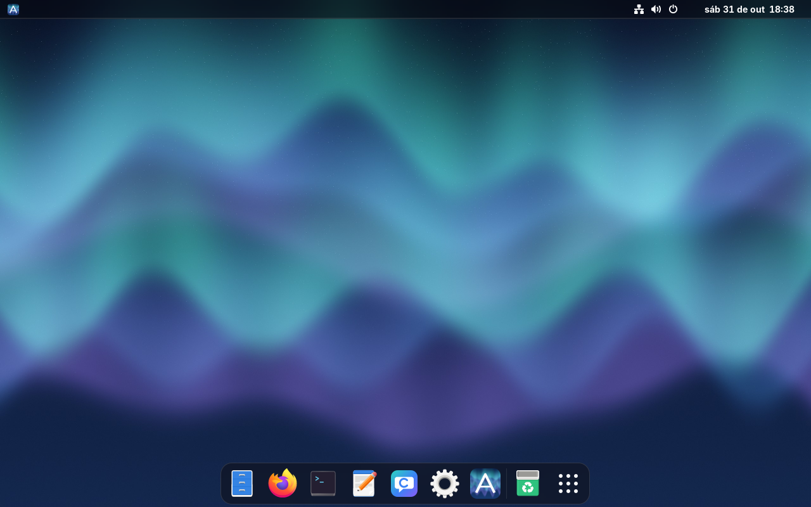
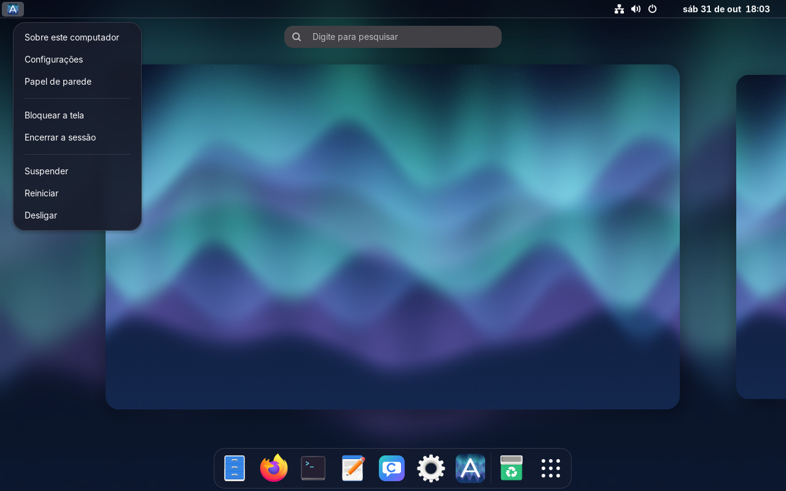
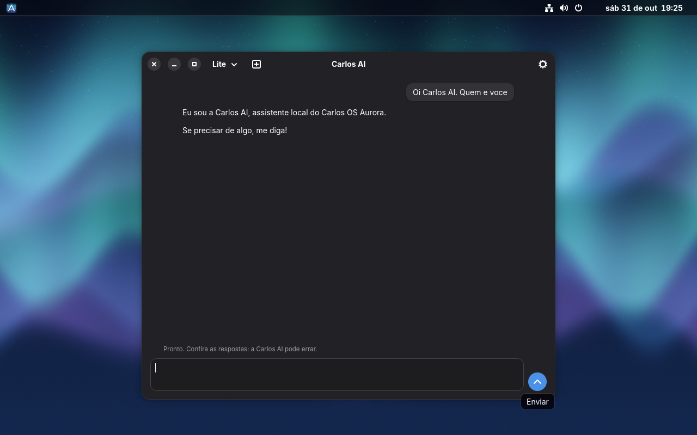
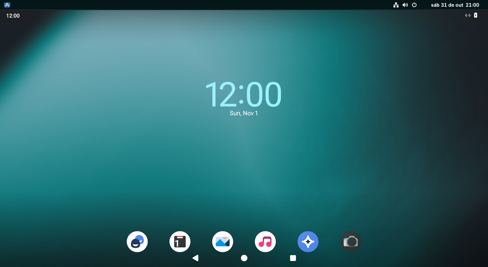
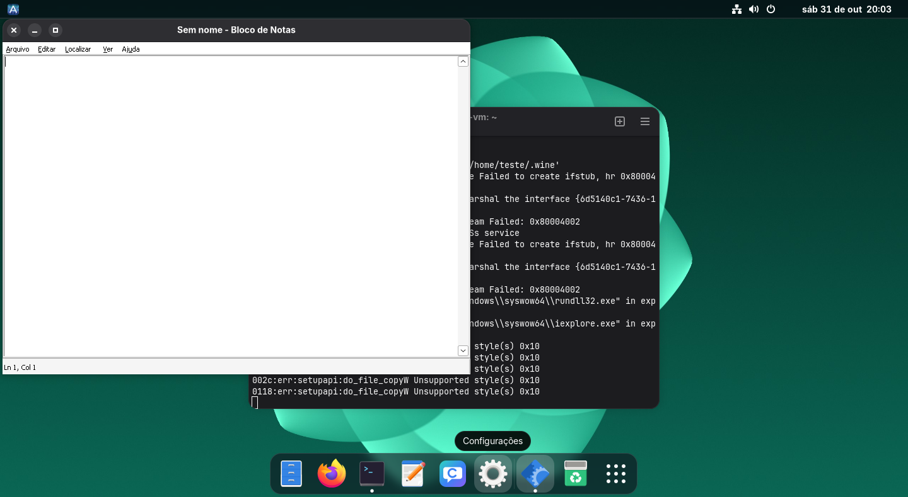
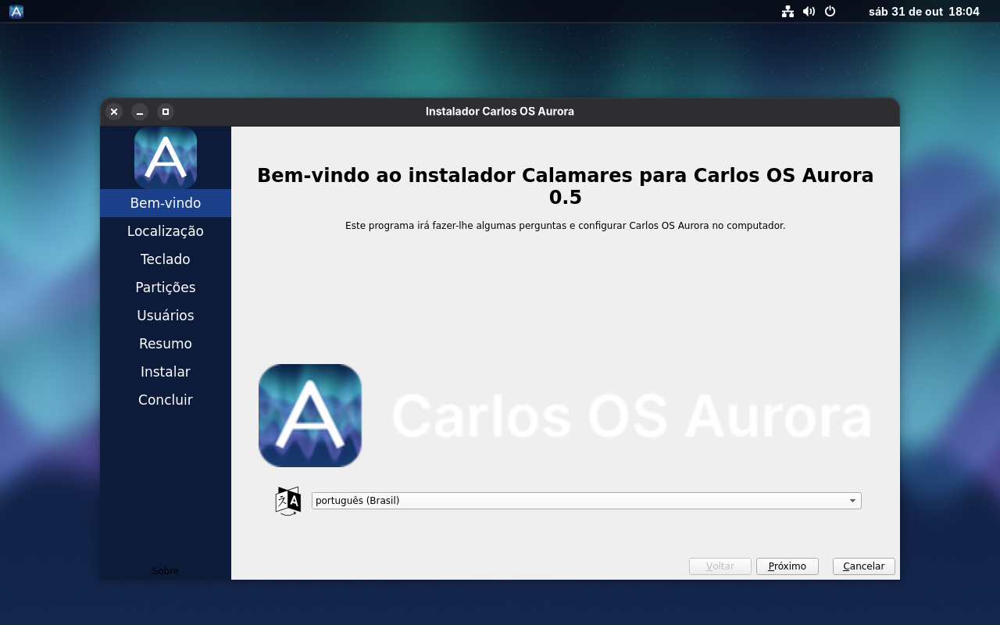
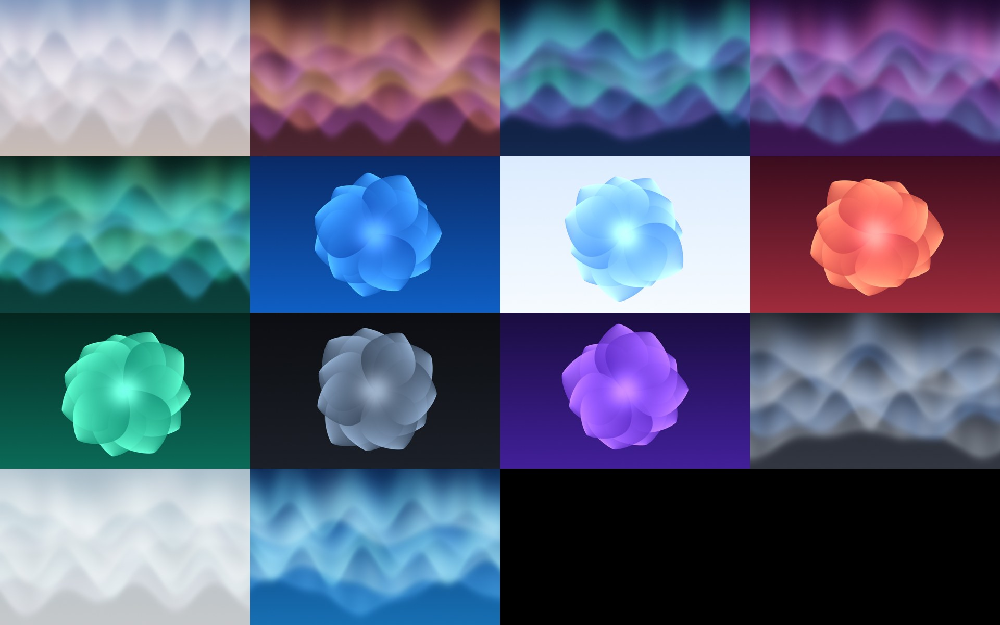

# Carlos OS Aurora

Distribuição Linux experimental com interface própria (CarlosUI), GNOME 51, papéis de parede originais
e assistente local (Carlos AI). A base é o Debian sid.

**Estado:** experimental. Use só em máquina virtual ou em computador sem dados importantes.
A situação real de cada parte está em [STATUS.md](STATUS.md), e os testes executados em [TESTES.md](TESTES.md).

## O que já funciona (testado em QEMU, UEFI)

- Sessão live com entrada automática
- Instalação em disco virtual e reinício sem a ISO
- Dock, barra e menus translúcidos, Menu Aurora e botões de janela à esquerda
- 14 papéis de parede próprios, gerados por `tools/gen-art.py`

- Carlos AI Lite respondendo em português
- Bloco de Notas de 64 bits pelo Wine e Android até a tela inicial, em testes na VM

## Fotos

Capturas reais em máquina virtual, sem aceleração gráfica.

| | |
|---|---|
|  Menu Aurora |  Carlos AI Lite |
|  Android (Waydroid) |  Programa Windows pelo Wine |
|  Instalador |  Papéis de parede |

## O que falta

Veja o [ROADMAP.md](ROADMAP.md). Prioridades: teste em computadores reais, ícones próprios, perfis de vidro
e testes da Carlos AI com modelo.

## Como construir

Em um Debian (no WSL ou nativo), como root:

    sh tools/setup-host.sh
    python3 -I tools/gen-art.py
    sh tools/build-iso.sh

A ISO e a lista exata de pacotes ficam em `out/`. Os testes usam `tools/test-iso.sh`, `tools/test-gui.sh` e `tools/vm.sh`.

## Como ajudar

Leia o [CONTRIBUTING.md](CONTRIBUTING.md).

## Licença e marcas

Código e arte deste repositório: GPL-3.0 ([LICENSE](LICENSE)). Cada pacote incluído na ISO mantém a própria licença.

Projeto independente, sem ligação com Apple, Microsoft ou o Projeto Debian. Não inclua fontes, logos, ícones ou
papéis de parede dessas empresas.
